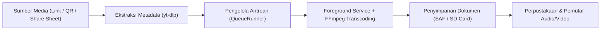

# Downlink — Pengunduh Audio/Video Publik

[](https://github.com/yehudaaadev/Downlink/releases/latest)
[](https://github.com/yehudaaadev/Downlink/releases/latest)
[-3DDC84?style=flat-square&logo=android&logoColor=white)](https://developer.android.com)
[](LICENSE)
[](app/src/test)

Aplikasi Android native (Kotlin, Jetpack Compose, MVVM) untuk mengunduh dan mengonversi media dari 1000+ platform publik tanpa server perantara, tanpa registrasi akun, dan tanpa iklan. Pemrosesan dilakukan sepenuhnya di perangkat menggunakan engine `yt-dlp` tersemat dan `FFmpeg`.

---

## Unduhan Langsung APK (v1.5.0)

| Berkas Aset | Target Perangkat | Arsitektur (ABI) | Perkiraan Ukuran | Tautan Unduh |
|---|---|---|---|---|
| `downlink-arm64-v8a-release.apk` | Mayoritas smartphone modern | 64-bit (`arm64-v8a`) | ~60 MB | [Unduh Langsung](https://github.com/yehudaaadev/Downlink/releases/latest/download/downlink-arm64-v8a-release.apk) |
| `downlink-armeabi-v7a-release.apk` | Perangkat lawas / hemat daya | 32-bit (`armeabi-v7a`) | ~53 MB | [Unduh Langsung](https://github.com/yehudaaadev/Downlink/releases/latest/download/downlink-armeabi-v7a-release.apk) |

> [!NOTE]
> Ukuran berkas APK mencakup runtime Python, binary native FFmpeg, dan engine yt-dlp terintegrasi agar aplikasi dapat beroperasi mandiri secara offline.

---

## Daftar Isi
- [Alur Kerja Sistem](#alur-kerja-sistem)
- [Fitur Utama](#fitur-utama)
- [Matriks Format & Kemampuan](#matriks-format--kemampuan)
- [Batasan Legal & Etika](#batasan-legal--etika)
- [Panduan Kompilasi Lokal](#panduan-kompilasi-lokal)
- [Struktur Arsitektur](#struktur-arsitektur)
- [Lisensi](#lisensi)

---

## Alur Kerja Sistem



---

## Fitur Utama

- **Dukungan Situs Universal**: Kompatibel dengan 1000+ situs publik yang didukung engine yt-dlp (YouTube, TikTok, Instagram, Facebook, X/Twitter, Reddit, Pinterest, Vimeo, SoundCloud, Bandcamp, Bilibili, dll).
- **Pemrosesan Lokal di Perangkat**: Tidak memerlukan relay server backend. Data dan riwayat unduhan tersimpan secara privat di penyimpanan lokal.
- **Penyimpanan Storage Access Framework (SAF)**: Berkas langsung disimpan di direktori pilihan pengguna (memori internal atau kartu SD) tanpa meminta izin penyimpanan luas yang invasif.
- **Editor Metadata ID3**: Mengubah judul, artis, dan metadata trek MP3 langsung dari riwayat; tag pada berkas MP3 fisik yang tersimpan ikut diperbarui.
- **Input Fleksibel**: Mendukung input manual, scan QR code kamera langsung, impor batch dari berkas teks/CSV/JSON, dan sistem Share Sheet Android dari aplikasi lain.
- **Manajemen Antrean Cerdas**: Antrean paralel (1 hingga 3 proses bersamaan), prioritisasi urutan, auto-retry, proteksi kuota (mode hanya Wi-Fi), dan penjadwalan harian.
- **Privasi Terkendali**: Penguncian aplikasi via PIN dan biometrik, mode penyamaran (tanpa riwayat), dukungan proxy lokal (Tor/Orbot), dan penghapusan jejak metadata.

---

## Matriks Format & Kemampuan

### Audio
| Format | Bitrate / Opsi | Dukungan Tag ID3 | Penyesuaian Normalisasi |
|---|---|---|---|
| MP3 | 64 kbps hingga 320 kbps (CBR/VBR) | ID3v2.4 (Judul, Artis, Cover Art) | Tersedia |
| M4A | Format asli kontainer AAC | Metadata MP4 atom asli | Tersedia |
| OPUS | Kualitas sumber asli | Vorbis comment | Tersedia |
| OGG / FLAC / WAV | Format terkompresi / lossless | Metadata bawaan kontainer | Tersedia |

### Video
| Format | Rentang Resolusi | Subtitle & Bab (Chapters) | Fitur Tambahan |
|---|---|---|---|
| MP4 | 144p hingga 4K (2160p) | Hardsub / Softsub tersemat / Berkas SRT terpisah | SponsorBlock filter |
| MKV | 144p hingga 4K (2160p) | Semua bahasa subtitle yang tersedia | Ekstraksi bab otomatis |
| WEBM | 144p hingga 4K (2160p) | Subtitle VTT / SRT | Ekstraksi thumbnail terpisah |

---

## Batasan Legal & Etika

> [!IMPORTANT]
> Aplikasi ini dirancang khusus untuk mengunduh konten publik yang dimiliki pengguna atau yang telah diizinkan untuk diarsipkan secara offline untuk kebutuhan pribadi.

- **Tanpa Dukungan Akun & Bypass**: Konten privat, konten berbayar, video dengan pembatasan usia yang memerlukan autentikasi akun, serta media berproteksi DRM tidak didukung dan tidak akan dibypass.
- **Integritas Atribusi**: Aplikasi tidak memodifikasi watermark pemilik konten dan tetap menyematkan URL sumber asli pada riwayat lokal.
- **Privasi Jaringan**: Aplikasi tidak mengumpulkan atau mengirimkan URL unduhan pengguna ke server analitik mana pun. Komunikasi keluar hanya terjadi langsung ke domain penyedia konten dan endpoint rilis GitHub untuk pembaruan engine.

---

## Panduan Kompilasi Lokal

### Kebutuhan Sistem
- JDK 17 (disarankan Eclipse Temurin atau OpenJDK 17)
- Android SDK Platform 34 (Android 14)
- Koneksi internet untuk sinkronisasi dependensi Gradle pertama kali

### Perintah Build

Kompilasi varian debug:
```powershell
$env:JAVA_HOME="C:\Program Files\Java\jdk-17"
.\gradlew.bat :app:assembleDebug
```

Menjalankan pengujian unit (54 unit test):
```powershell
.\gradlew.bat :app:testDebugUnitTest
```

Kompilasi berkas APK rilis (tersedia optimasi R8 dan pemisahan ABI):
```powershell
.\gradlew.bat :app:assembleRelease
```

Hasil berkas binary rilis akan berada pada direktori:
`app/build/outputs/apk/release/`

---

## Struktur Arsitektur

Proyek mengadopsi Clean Architecture yang dipadukan dengan pola MVVM dan Jetpack Compose:

```
app/src/main/java/com/example/yt2mp3/
├── data/
│   ├── database/        # Room Database entitas & DAO riwayat unduhan
│   ├── engine/          # Integrasi yt-dlp binary wrapper & manajemen versi
│   ├── queue/           # Antrean unduhan konkuren & event bus progres
│   ├── storage/         # Abstraksi Storage Access Framework (SAF) & ID3 writer
│   └── update/          # Komponen pengecekan pembaruan GitHub Releases
├── domain/
│   ├── model/           # Value object, enum konfigurasi, & domain models
│   ├── repository/      # Kontrak repositori antrean dan riwayat
│   └── usecase/         # Logika orkestrasi unduh, validasi format, & retry
├── service/             # Foreground Service Android & broadcast receivers
└── ui/
    ├── home/            # Layar penelusuran, parser URL, & konfigurasi format
    ├── downloads/       # Pengawasan antrean aktif & visualisasi progres
    ├── history/         # Riwayat berkas tersimpan, editor tag, & pemutar
    ├── settings/        # Preferensi penyimpanan, jaringan, proxy, & tampilan
    └── theme/           # Sistem tema Material 3 netral
```

---

## Lisensi

Kode sumber aplikasi **Downlink** dirilis di bawah naungan lisensi **MIT**. Rincian lengkap hak penggunaan dan redistribusi dapat dilihat pada berkas [LICENSE](LICENSE).

Komponen pihak ketiga yang digunakan dalam repositori ini:
- `yt-dlp` (Unlicense)
- `youtubedl-android` (Apache-2.0 / LGPL)
- `FFmpeg` (LGPL-2.1 / GPL)
- `Android Jetpack & Compose` (Apache-2.0)
